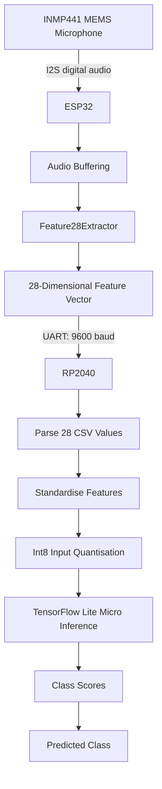

# System Architecture

## 1. Overview

The system is a distributed audio-classification prototype built around two microcontrollers: an ESP32 for audio acquisition and feature extraction, and an RP2040-based device for embedded inference.

Rather than transmitting raw audio between devices, the ESP32 computes a compact 28-dimensional feature vector and sends it over UART. The RP2040 standardises the received features and passes them to an int8-quantised TensorFlow Lite model to classify the audio into one of four categories: clap, music, noise, or speech.

The current implementation focuses on the acquisition-to-inference pipeline. Adaptive sampling is a planned extension.

## 2. Hardware Components

| Component | Role |
|---|---|
| ESP32 | Audio acquisition and feature extraction |
| INMP441 MEMS microphone | Digital audio input through I²S |
| RP2040-based device | Feature processing and neural-network inference |
| USB serial connection | Firmware diagnostics and debugging |
| UART connection | Transfer of feature vectors between microcontrollers |

## 3. Architecture Diagram



## 4. ESP32: Audio Acquisition and Feature Extraction

### 4.1 Microphone interface

The INMP441 microphone is connected to the ESP32 through I²S. The firmware configures the ESP32 as the I²S master and receiver.

| Parameter | Configuration |
|---|---|
| Sampling rate | 16,000 Hz |
| I²S port | `I2S_NUM_0` |
| Bit depth configured in firmware | 16 bits |
| Channel format | `I2S_CHANNEL_FMT_ONLY_LEFT` |
| BCLK | GPIO 32 |
| Word select / LRCK | GPIO 25 |
| Data input | GPIO 33 |
| DMA buffer count | 8 |
| DMA buffer length | 256 |

The firmware requests audio data using `i2s_read()` and stores the returned samples in an `int16_t` buffer.

### 4.2 Recording window

The firmware accumulates 32,000 samples per recording window:

\[
N=f_sT=16{,}000\times2=32{,}000
\]

where \(f_s\) is the nominal sampling rate and \(T\) is the recording duration.

Audio is read in chunks of up to 512 16-bit samples. Each chunk is passed to `Feature28Extractor::feed()`. After the recording window is complete, the firmware calls `compute()` to generate the feature vector.

The extractor is reset after successful computation so that the next window can be processed independently. The current sketch also resets the extractor if feature computation fails.

### 4.3 Feature extraction

The `ESP32Feature28` library computes 28 features:

| Indices | Feature | Count |
|---|---|---:|
| 0 | Peak frequency | 1 |
| 1 | Spectral centroid | 1 |
| 2–14 | MFCC means | 13 |
| 15–27 | MFCC standard deviations | 13 |
| | **Total** | **28** |

The extractor processes audio using FFT-based spectral analysis and MFCC calculations. The MFCC statistics summarise the distribution of the extracted coefficients over the recording window.

The resulting feature vector is a compact representation of the audio signal intended for classification without transferring the complete waveform.

The exact FFT sizes, MFCC frame lengths, hop size, and mel-filter parameters are defined in the `ESP32Feature28` library headers and implementation.

## 5. Inter-Microcontroller Communication

The ESP32 transmits the feature vector to the RP2040 using UART.

| Parameter | ESP32 | RP2040 |
|---|---|---|
| UART baud rate | 9600 | 9600 |
| Transmit pin | GPIO 17 | GPIO 4 |
| Receive pin | GPIO 16 | GPIO 5 |
| Data format | 8 data bits, no parity, 1 stop bit | 8 data bits, no parity, 1 stop bit |

The feature vector is encoded as comma-separated floating-point values followed by a newline.

Conceptually, a message has the following format:

```text
f0,f1,f2,...,f27\n
```

Each complete line represents one recording window and contains exactly 28 features.

The physical connection requires the ESP32 TX pin to connect to the RP2040 RX pin, the RP2040 TX pin to the ESP32 RX pin if bidirectional communication is required, and a shared ground.

The ESP32 sketch includes UART transmission after feature extraction. During dataset collection, this transmission can be disabled while the feature vector is printed over USB serial.

## 6. RP2040: Preprocessing and Inference

### 6.1 UART parsing

The RP2040 reads incoming UART data character by character and accumulates it in a line buffer. On receiving a newline, it parses the message into 28 floating-point values.

The firmware rejects malformed numeric values, incorrect feature counts, and lines that exceed the buffer capacity.

### 6.2 Standardisation

The model expects standardised features rather than raw extracted features.

For each feature \(i\), the RP2040 applies the saved training preprocessing parameters:

\[
z_i=\frac{x_i-\mu_i}{s_i}
\]

where:
- \(x_i\) is the received feature,
- \(\mu_i\) is the corresponding training mean,
- \(s_i\) is the corresponding training scale.

The parameters are stored in `preprocessing.h` and must match the preprocessing used when training the deployed model.

### 6.3 Quantised inference

The RP2040 loads the model from `sound_model.h` using the `MicroTFLite` library. A 16 KiB tensor arena is allocated for inference.

The firmware passes the standardised values to the model input interface and invokes inference. The model uses int8 input and output tensors, with the input quantisation scale and zero point configured in the firmware.

The four output scores correspond to the class order:

1. `clap`
2. `music`
3. `noise`
4. `speech`

The firmware selects the class with the highest output score and prints the scores, predicted label, and inference execution time over USB serial.

## 7. Data and Model Pipeline

The Python scripts support the development and evaluation workflow:

- `collect_dataset.py` collects labelled feature vectors.
- `train.ipynb` trains and evaluates the Random Forest classifier.
- `train.py` trains the neural network and generates the floating-point and quantised TFLite models.
- `test.py` evaluates the quantised model.
- `preprocessing.py` exports preprocessing parameters for embedded use.

The model files are stored in `models/`, while the generated embedded headers are stored in `headers/`.

The deployed model and preprocessing parameters must be generated from the same training run to maintain consistency between desktop evaluation and embedded inference.


